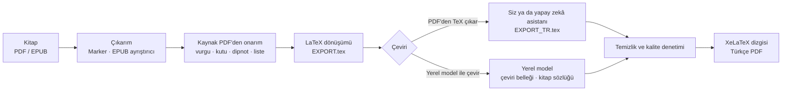

<h1 align="center">Kitapçevir</h1>

<p align="center">
  <strong>Akademik ve teknik kitapları Türkçeye çeviren, sonucu dizgisi yapılmış bir PDF olarak veren macOS uygulaması</strong><br>
  PDF / EPUB &rarr; Türkçe PDF &mdash; formüller, şekiller, tablolar, dipnotlar ve çapraz referanslar yerinde kalır
</p>

<p align="center">
  <a href="https://github.com/berketez/kitap_cevir/releases/latest"></a>
  
  
  
</p>

<p align="center">
  <a href="https://github.com/berketez/kitap_cevir/releases/latest"><strong>DMG'yi indir</strong></a>
  &nbsp;·&nbsp; <a href="docs/KURULUM_VE_KULLANIM.md">Kurulum ve kullanım rehberi</a>
  &nbsp;·&nbsp; <a href="docs/Kullanma_Kilavuzu.pdf">PDF kılavuz</a>
</p>

---

Genel amaçlı çeviri araçları akademik kitabı bozar: LaTeX komutlarını çevirir, denklem numaralarını karıştırır, çapraz referansları koparır, aynı terimi her sayfada başka türlü çevirir. Kitapçevir kitabı önce LaTeX'e dönüştürür, teknik öğeleri (denklemler, `\ref` / `\cite` / `\label`, şekiller, tablolar) çeviriden ayırıp korur, yalnız doğal dildeki metni çevirtir ve sonucu kalite denetiminden geçirip XeLaTeX ile dizer.

*In English: Kitapçevir is a macOS (Apple Silicon) app that translates academic and technical books (PDF/EPUB) into Turkish and typesets the result with XeLaTeX, keeping equations, figures, tables, footnotes and cross-references intact.*

> **Durum:** 1.0 yayımlandı. Proje bakım modunda: yalnız hata düzeltmeleri.

## Öne çıkanlar

- **İki çeviri yolu.** "PDF'den TeX çıkar" ile çeviriyi siz ya da bir yapay zekâ asistanı (ör. Claude Code) yaparsınız, "Yerel model ile çevir" ile bilgisayarınızdaki model çevirir. İkisinde de dizgi ve denetim aynıdır.
- **Altı kaynak dil.** İngilizce, Almanca, Rusça, Fransızca, İspanyolca, İtalyanca. Hedef dil her zaman Türkçe.
- **Kayıpsız çeviri.** Hiçbir cümle, dipnot, tablo hücresi ya da altyazı bilerek atlanmaz. Yalnız sayfalama artıkları (sayfa numarası, sızmış üst bilgi, devam eden tablonun yinelenen başlığı) silinir ve sayılır.
- **Kaynak PDF'den onarım.** PDF çıkarımının (Marker) düşürdüğü kalın/italik vurgu, çerçeveli kutular, dipnot numaraları, bölünmüş paragraf ve tablolar, kesintili numaralı listeler ve dar bağlantılar kaynak PDF'nin metin ve çizim katmanından geri getirilir.
- **Kitap sözlüğü.** Her kitap kendi terim sözlüğünü (`glossary_shared.tsv`) kaynak dilde tutar; terim tutarlılığı bu sözlükle denetlenir.
- **Kalite denetimi.** Çevrilmeden kalan cümle, bozulan formül, kayan numara, eksik dipnot ve yapı farkları raporlanır; derleme günlüğünden TeX hataları ve eksik glifler okunur.
- **Yerel ve çevrim dışı.** Yerel model yolunda metin internete gönderilmez. Önerilen model HY-MT 1.5 7B; Ollama, LM Studio ve GGUF modelleri de seçilebilir.

## İndir ve kur

1. [Releases](https://github.com/berketez/kitap_cevir/releases/latest) sayfasından `Kitapcevir-1.0.0.dmg`'yi indirin, açın ve **Kitapçevir**'i **Uygulamalar** klasörüne sürükleyin.
2. Uygulama imzasızdır. İlk açılışta Finder'da uygulamaya sağ tıklayıp **Aç**'ı seçin. macOS 15 ve sonrasında gerekirse **Sistem Ayarları → Gizlilik ve Güvenlik → Yine de Aç**.
3. Uygulamanın içindeki **kurulum sihirbazı** Mac'inizi denetler, lisansları gösterip onaylatır ve seçtiğiniz bileşenleri yayıncılarının sunucularından indirir. Zorunlu kurulum (Hafif TeX ile) yaklaşık 3,8 GB indirir, diskte 5 GB yer kaplar. HY-MT 1.5 7B çeviri modeli isteğe bağlıdır (yaklaşık 15 GB).

**Gereksinim:** macOS 14 ya da sonrası, Apple Silicon (M serisi) Mac. Uygulama Intel Mac'te, Linux'ta ve Windows'ta çalışmaz.

## Donanım gereksinimi

**PDF'den TeX çıkar** her Apple Silicon Mac'te çalışır. **Yerel model ile çevir** güçlü donanım ister: HY-MT 1.5 7B ile 20 sayfalık bir kitabın çevirisinde ölçülen tepe bellek kullanımı yaklaşık 26 GB'tı (36 GB belleği olan bir Mac'te). Uygulama Mac'in kullanılabilir belleğini modelin tahmini gereksinimiyle karşılaştırır; yetmiyorsa yerel model kartını nedenini sayılarla yazarak kapatır, komut satırı da çıkarımdan önce durur. Formül, ölçümler ve kaynakları: [docs/DONANIM_VARSAYIMLARI.md](docs/DONANIM_VARSAYIMLARI.md).

## İki çeviri yolu

| | **PDF'den TeX çıkar** (önerilen) | **Yerel model ile çevir** (Beta) |
|:--|:--|:--|
| Çeviriyi kim yapar | Siz ya da bir yapay zekâ asistanı | Bu Mac'teki çeviri modeli (önerilen: HY-MT 1.5 7B) |
| Çeviri modeli | Gerekmez | Gerekir (HY-MT diskte ~15 GB) |
| Donanım | Her Apple Silicon Mac | Güçlü donanım (aşağıda "Donanım gereksinimi") |
| Kalite | Çeviriyi yapana bağlı; en iyi sonuç bu yoldadır | Ön okuma ve taslak kalitesi |
| Akış | TeX'i çıkar → çevir → derle | Kitabı baştan sona kendisi çevirir ve dizer |

**PDF'den TeX çıkar:** Uygulama kitaptan çevrilmeye hazır `EXPORT.tex`'i çıkarır. Çeviriyi aynı klasöre `EXPORT_TR.tex` adıyla kaydedersiniz; uygulama onu dizip Türkçe PDF üretir. Kaynak kodla çalışıyorsanız proje klasöründe Claude Code'a **"bu kitabı çevir"** demeniz yeter: asistan [CEVIRI_TALIMATI.md](CEVIRI_TALIMATI.md)'ye göre çıkarır, çevirir ve derler.

**Yerel model ile çevir (Beta):** Model kitabı baştan sona çevirir; kalite denetimi ve dizgi kendiliğinden ilerler. Çıktının başında, metnin hangi modelle çevrildiğini ve gözden geçirilmemiş bir taslak olduğunu yazan kısa bir künye bulunur. Uygulama Mac'in belleğini ölçer; model sığmıyorsa bu yolu nedenini yazarak kapatır.

**Yerel modelin kaynakları:** Önerilen ve en çok sınanan model **HY-MT 1.5 7B**'dir (Tencent; MLX biçimi); kalite denetiminin eşikleri onun çıktısına göre ayarlıdır. Model listesinden şunlar da seçilebilir: `models/` klasöründeki (DMG kurulumunda `veri/models/`) bir MLX klasörü ya da GGUF dosyası, Ollama, LM Studio ya da OpenAI uyumlu başka bir yerel sunucu. Bunlar desteklenir ama Beta düzeyindedir ve daha az sınanmıştır. **Modelleri tara** yalnız `models/` klasörüne ve bu bilgisayarda açık sunuculara bakar (varsayılan adresler: `config/defaults.py`); başka yerdeki bir model `models/` altına sembolik bağla konur. Çeviri belleği model başına ayrıdır. Düşünen modellerde düşünme resmî yolla kapatılabiliyorsa kapatılır, kapatılamıyorsa model düşünerek çevirir. Seçili model kullanılamıyorsa iş çevirmeden durur (komut satırında çıkış kodu 5). Ayrıntı: [docs/YENI_MODEL_EKLEME.md](docs/YENI_MODEL_EKLEME.md).

**Yerel modelde dil denetimi:** İngilizceden başka kaynak dillerde çeviri kalitesi seçilen modele bağlıdır; HY-MT 1.5 7B ile bu dillerden yalnız kısa Almanca ve Rusça deneme belgeleri sınandı. Kitabın dili iki kapıda ölçülür: **ön kapı** çıkarımdan önce PDF'nin metin katmanına ya da EPUB metnine bakar, **tam kapı** çıkarımdan sonra çıkarılan metni ölçer. Kitap desteklenmeyen bir dildeyse iş çeviri başlamadan çıkış kodu 4 ile durur ve arayüz "Yerel model bu kitabı çevirmedi: kitabın dili desteklenmiyor" der. Tespit yanlışsa dil arayüzdeki **Kaynak dil** listesinden ya da komut satırında `--kaynak-dil KOD` ile seçilir; iki kapıyı birden atlayan `--dil-kontrolu-yok` bayrağı arayüzde yoktur.

## Nasıl çalışır?



TeX yolunda derleme *manuel çeviri kipinde* çalışır: yapısal denetimler aynen yapılır, ama çevirmenin sözcük seçimlerinin üzerine yazılmaz. EPUB kaynaklı kitapta Türkçe EPUB de üretilir.

## Kullanım

**Arayüz.** Kitabı (PDF ya da EPUB) sürükleyin; iki kart belirir.

- **PDF'den TeX çıkar:** "1 · TeX'i çıkar" → `EXPORT.tex` → çeviriyi `EXPORT_TR.tex` olarak kaydedin → "2 · Çevrilmiş TeX'i derle" → PDF.
- **Yerel model ile çevir:** model ve kaynak dil seçilir → "Çevir". Seçili model kullanılamıyorsa düğme kapalı kalır, nedeni altında yazar.
- **Araçlar:** Terimler (kitabın sözlüğü), Bellek (çeviri belleği), Karşılaştırma (iki PDF'nin sayfa sayfa farkı).

İlerleme yalnız gerçek sayaçlardan (faz, sayfa, segment, geçen süre) gösterilir; iş "İptal" ile durdurulabilir. Sonuçta "PDF'yi aç" ve "İndir" düğmeleri çıkar.

**Komut satırı** (kaynak koddan kurulumda):

```bash
python 1_cikar.py kitap.pdf                    # → output/<ad>/EXPORT.tex
python 2_derle.py output/<ad>/EXPORT_TR.tex    # → Türkçe PDF
python translate_book.py kitap.pdf             # yerel modelle baştan sona çeviri
python -m core.mt_engines.discovery            # bulunan modeller ve sunucular
```

## Kaynak koddan kurulum

Apple Silicon Mac, arm64 Python 3.12 ve XeLaTeX içeren bir TeX dağıtımı gerekir.

```bash
git clone https://github.com/berketez/kitap_cevir.git kitapcevir
cd kitapcevir
python3.12 -m venv venv && source venv/bin/activate
pip install --no-deps -r requirements.txt   # --no-deps gerekli; requirements.txt başındaki nota bakın
brew install --cask mactex                  # XeLaTeX yoksa
streamlit run app.py                        # → http://127.0.0.1:8501
```

Marker kendi modellerini (~3,5 GB) ilk PDF'de indirir. Yerel model yolu için HY-MT'yi MLX biçimine dönüştürün:

```bash
./venv/bin/mlx_lm.convert --hf-path tencent/HY-MT1.5-7B --mlx-path models/hymt-7b-mlx
```

GGUF dosyasını Ollama ya da LM Studio olmadan doğrudan açmak için isteğe bağlı llama-cpp-python gerekir:

```bash
CMAKE_ARGS="-DGGML_METAL=on" ./venv/bin/pip install llama-cpp-python
```

Testler çeviri modeli gerektirmez: `pip install pytest && python -m pytest -q`.

## Belgeler

- [Kurulum ve kullanım rehberi](docs/KURULUM_VE_KULLANIM.md): her ekran, her seçenek, çıkış kodları, veri klasörleri
- [Yeni model ekleme](docs/YENI_MODEL_EKLEME.md): MLX klasörü, Ollama, LM Studio, GGUF
- [Donanım varsayımları](docs/DONANIM_VARSAYIMLARI.md): bellek formülü, ölçümler ve kaynakları
- [PDF kılavuz](docs/Kullanma_Kilavuzu.pdf)

## Bilinen sınırlamalar

- Yalnız macOS + Apple Silicon.
- "Yerel model ile çevir" Beta'dır. Çeviri kalitesi modele bağlıdır ve TeX yolundaki dikkatli çeviriden belirgin biçimde düşüktür.
- Kaynak PDF'den onarımlar metin katmanı gerektirir; taranmış PDF'lerde yapılamaz.
- Gerçek kod bloklarında (düzyazı olmayan) kalın/italik vurgu gösterilmez; çerçeveli kutular tek tip (gri) basılır.

## Telif notu

Bu depo yalnız pipeline kodunu içerir. Kitap dosyaları ve çeviri çıktıları depoya eklenmez; üretilen çeviriler yalnız kişisel kullanım içindir (FSEK m. 38).

## Lisans

Telif hakkı © 2026 Berke Tezgöçen. Kitapçevir GNU GPL v3.0 ile dağıtılır; tam metin [`LICENSE`](LICENSE) dosyasındadır.

Kullandığı ya da kurulumda indirdiği üçüncü taraf bileşenler kendi lisanslarıyla gelir; bağlayıcı olan resmî metinlerdir:

- **Marker ve Surya** (PDF çıkarımı): kod GPL-3.0-or-later; model ağırlıkları Datalab'ın model lisansıyla sunulur ([marker](https://github.com/datalab-to/marker), [surya](https://github.com/datalab-to/surya)). Sihirbaz indirmeden önce lisansı gösterip onay ister.
- **PyMuPDF** (GNU AGPL-3.0 ya da Artifex ticari lisansı) ve **EbookLib** (GNU AGPL-3.0-or-later): [PyMuPDF](https://github.com/pymupdf/PyMuPDF), [ebooklib](https://github.com/aerkalov/ebooklib).
- **HY-MT 1.5 7B** (isteğe bağlı çeviri modeli): Tencent HY Community License ([metin](https://huggingface.co/tencent/HY-MT1.5-7B)). Kitapçevir bağımsız bir projedir; Tencent ile bağlantılı değildir, Tencent tarafından desteklenmez ya da onaylanmaz.
- **TeX:** tectonic (MIT); tectonic'in indirdiği TeX paketleri ve MacTeX, TeX Live bileşenlerinin kendi özgür lisanslarıyla gelir.

Uygulamadaki **Bileşenler → Lisanslar** bağlantısı, Kitapçevir'in GPL metnini, kaynak kodu bağlantılarını ve kurulan bileşenlerin lisans dosyalarını içeren klasörü açar.
